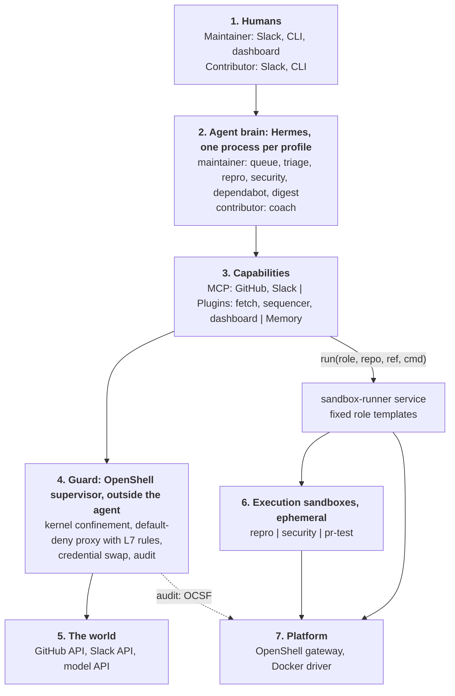
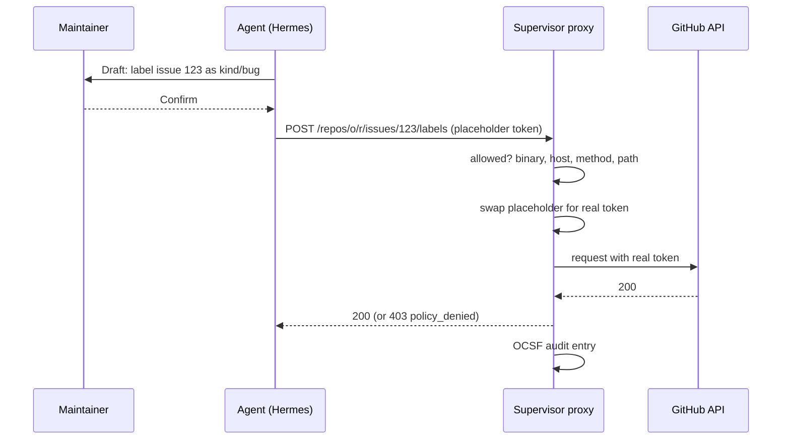

# OpenShell architecture

How the assistant runs inside [NVIDIA OpenShell](https://docs.nvidia.com/openshell), what each
layer is responsible for, which bots and features sit on top, and how it compares to similar
projects. Kyverno policy enforcement and the Kubernetes deployment are specified in
[section 11](#11-later-kyverno-and-kubernetes) and are not part of the first build.

Claims are tagged **[V]** verified in documentation or source, **[I]** inferred from documented
behavior, **[?]** unverified and listed in [section 9](#9-verified-and-still-to-verify).

## Built so far

The terminal and its audit trail are shipped; everything else in this document is design.
User documentation is [openshell.md](openshell.md).

- Hermes runs on the laptop. Its terminal (and, with the ssh backend, file tools) run inside one
  OpenShell sandbox, `kyverno-terminal`, reached over ssh.
- Policy `policies/terminal.yaml`: read-only GitHub for `curl` and `git`, default-deny otherwise.
- Policy advisor: the agent proposes a rule, the maintainer approves with `scripts/openshell.sh rules`.
- Audit: `scripts/openshell.sh audit`, with a launchd collector writing daily logs.
- `scripts/install.sh` sets it all up; `scripts/update.sh` updates it.
- Not built: Hermes inside a sandbox, `sandbox-runner`, the contributor profile, Kyverno enforcement.

## Contents

1. [At a glance](#1-at-a-glance)
2. [Layers](#2-layers)
3. [Profiles and bots](#3-profiles-and-bots)
4. [One guarded write](#4-one-guarded-write)
5. [How OpenShell works](#5-how-openshell-works)
6. [Features](#6-features)
7. [Flaky tests live in GitHub Actions](#7-flaky-tests-live-in-github-actions)
8. [Comparison: Hive Commons, NemoClaw, GitHub Agentic Workflows](#8-comparison)
9. [Verified and still to verify](#9-verified-and-still-to-verify)
10. [Phases](#10-phases)
11. [Later: Kyverno and Kubernetes](#11-later-kyverno-and-kubernetes)
12. [Hardening checklist](#12-hardening-checklist)
13. [Sources](#13-sources)

## 1. At a glance

- **Two Hermes profiles**: `maintainer` and `contributor`. Bots are skills, personalities,
  cron jobs, and delegated workers inside a profile, not extra profiles.
- **The agent is advisory by construction.** It reads, drafts, and runs analysis. A human
  confirms every write. Merge is impossible at every layer.
- **OpenShell is the boundary.** Each profile runs in its own sandbox with default-deny
  egress. Tokens never enter the sandbox; the proxy swaps placeholders on the wire.
- **Risky work runs elsewhere.** Reproducing an issue or running a fork PR's code happens in a
  short-lived execution sandbox with no tokens, requested through a `sandbox-runner` service.
- **Flaky-test detection runs in GitHub Actions** on `kyverno/kyverno`. The assistant only
  reads its results ([section 7](#7-flaky-tests-live-in-github-actions)).
- **Kyverno enforcement is a later phase.** Until then, the body-level gap in OpenShell's rules
  is covered by confirmation, token scope, and binary-bound egress
  ([section 4](#the-gap-until-kyverno-is-added)).

## 2. Layers

| Layer | Does | Does not |
|---|---|---|
| 1 Humans | Ask, confirm, approve policy proposals | |
| 2 Brain | Reasons, drafts, remembers, schedules | Hold tokens or choose its own permissions |
| 3 Capabilities | Typed tools: GitHub and Slack MCP, fetch, sequencer, dashboard | Reach the network except through the guard |
| 4 Guard | Confines the process, allows only listed host/binary/method/path, swaps credentials, logs | Read request bodies (until Kyverno is added) |
| 5 World | GitHub, Slack, model provider | |
| 6 Execution sandboxes | Run untrusted code or commands, return artifacts | Hold tokens; allow egress beyond a fixed list |
| 7 Platform | Creates sandboxes, stores credentials, delivers policy | |

Each Hermes profile runs inside its own OpenShell sandbox **[I]**, so all of its traffic
crosses the supervisor. The `sandbox-runner` holds gateway credentials; the brain can only ask
it for a fixed role template.

## 3. Profiles and bots

Hermes constraints that shape this **[V]**: a profile is one `HERMES_HOME`; two agent processes
must never share one; one messaging gateway serves every profile on a host; toolsets are per
profile; `delegate_task` workers inherit toolsets and cannot use memory, cron, or
`send_message`; personalities are session overlays on `SOUL.md`; cron jobs run in fresh
sessions with their own skills.

Authority therefore comes from the profile's sandbox and from execution sandboxes, not from
which bot is talking.

| Profile | For | Credential | Sandbox policy |
|---|---|---|---|
| `maintainer` | a Kyverno maintainer | the maintainer's token | comments, labels, reviews, issue edits; no merge, no branch protection, no workflow dispatch |
| `contributor` | a contributor | the contributor's own token | read-mostly; writes only on the contributor's own PRs |

| Bot | Profile | Trigger | Execution sandbox | Writes (after confirmation) |
|---|---|---|---|---|
| Queue and triage (existing) | maintainer | request, digest cron | none | comments, labels, reviews |
| Dependabot (existing) | maintainer | request | none | comments |
| Repro | maintainer | issue triage, request | `repro`: pinned Kyverno CLI or source, no tokens, egress to release hosts only | issue comment with evidence |
| PR test run | maintainer | request | `pr-test`: fork PR code, no tokens, egress report | comment with results |
| Kyverno policy review | maintainer | PR touching policies or tests | `pr-test` | comment with `kyverno test` / `apply` output |
| Security and vulnerability | maintainer | request, cron | `security`: advisory hosts only | none public; findings go to the dashboard and a private channel |
| Main-branch watch | maintainer | cron | none | none; dashboard only |
| Coach | contributor | request | none | comments on the contributor's own PR |

Execution sandboxes are created per task from fixed templates, destroyed afterward, and return
artifacts (logs, JUnit XML, egress report). The brain cannot create a sandbox with a policy of
its own choosing.

## 4. One guarded write

### The gap until Kyverno is added

OpenShell's built-in rules match method, path, and query, not bodies **[V]**. Closing an issue
and editing its labels are both `PATCH /issues/N`; approving and requesting changes are both
`POST /pulls/N/reviews`. Until a body-aware check exists, these controls apply **[I]**:

1. Every write is confirmed by the maintainer, and the draft shows the exact action.
2. The `pre_tool_call` hook receives the full tool arguments **[V]** (spike 5), so it can
   reject, rewrite, or force a human prompt for, say, a review with `event: APPROVE` that the
   maintainer did not request. Hermes names MCP tools `mcp__<server>__<tool>` and applies the
   hook `matcher` with a full-match regex, so the current `merge|delete_repo|force_push`
   matcher does not match `mcp__github__merge_pull_request`; it needs wildcards.
3. Rules bind to **binaries**: only the MCP server process may reach `api.github.com`; a
   Python script in the sandbox cannot. A binary rule also covers programs that *launch* a
   listed binary, so the list must name only the MCP server, and the image must not carry
   `curl`, `gh`, or `git` for those hosts (spike 2, test 7). The hook's argument checks then
   cover the only path to GitHub.
4. The token has no merge permission, and path rules deny `PUT /pulls/*/merge`.

## 5. How OpenShell works

**Components [V].** The *gateway* is the control plane (creates sandboxes, stores credentials,
delivers policy; gRPC with mTLS). The *supervisor* runs outside the agent's process (kernel
confinement, proxy, policy, credential injection, audit). The *sandbox* is the container or VM
holding the agent. Drivers: Docker, Podman, Kubernetes, MicroVM.

**Policy [V].**

| Section | Enforced by | Changeable while running |
|---|---|---|
| `filesystem`, `landlock`, `process` | kernel (Landlock ABI 3+, seccomp) | no |
| `network_policies` | proxy: binary + host + port + L7 | yes, hot reload |
| `network_middlewares` | supervisor middleware (gRPC) | yes |

Precedence: gateway-global, then the sandbox's saved policy, then the image's policy, then the
default (no network rules, so deny all).

**Credentials [V].** A provider profile declares credentials, endpoints, and the binaries
allowed to use them. The sandbox sees only a placeholder; the proxy substitutes the real value
when both the network rule and the endpoint binding match.

**What L7 rules can see [V].**

| Protocol | Matchable |
|---|---|
| REST | method, path glob, query parameters |
| GraphQL | operation type, operation name, top-level fields |
| MCP (Streamable HTTP only) | method, tool name |
| JSON-RPC, WebSocket | method, text message |

Not matchable: bodies, header values, MCP tool arguments.

**Approvals, prover, audit [V].** When a request is denied, the agent can propose a narrow
rule; it stays pending until a human approves (`openshell rule approve-all` or the TUI), then
hot-reloads. The prover (`openshell-prover`) checks with an SMT solver that a policy grants no
more than a boundary policy, for filesystem, process, network, and REST rules only. Audit is
OCSF via `openshell logs`; the gateway keeps about 2,000 lines per sandbox in memory, so
durable retention needs export.

### MCP servers: stdio and HTTP

Hermes supports both **[V]**. *stdio*: Hermes starts the server as a local program and talks
through a pipe. *HTTP*: the server runs elsewhere and Hermes calls it over the network.

| | Used by | Under OpenShell |
|---|---|---|
| stdio (current) | `github` (`docker run github-mcp-server`), `slack` (`slack-mcp-server`) | The pipe is local and needs no checking. The server's calls out to GitHub and Slack cross the proxy, so network rules, credential swap, and audit apply **[I]**. OpenShell's MCP-aware rules (allow by tool name) do not apply; `GITHUB_EXCLUDE_TOOLS`, `tools.include`, and the merge hook do that job. The server program must be installed in the sandbox image because Docker is probably not available inside it **[?]**. |
| HTTP | GitHub's hosted server, `https://api.githubcopilot.com/mcp/` **[V]**; Slack server's own HTTP mode **[V]** | MCP-aware rules and credential swap in the `Authorization` header apply, which is how NemoClaw's managed MCP works **[V]**. |

The hosted GitHub server needs no local install and restricts tools through `X-MCP-Tools`,
`X-MCP-Readonly`, or a `/readonly` URL **[V]**. Tested (spike 4): it accepts a PAT, exposes all 36
tools in `tools.include`, returns exactly those 36 when `X-MCP-Tools` lists them (no merge tool),
and from inside a sandbox OpenShell's `protocol: mcp` rules allowed `get_file_contents`, denied an
unlisted tool, and denied `merge_pull_request` with a deny rule **[V]**. Rules match tool names,
not arguments. Not yet checked: Hermes' HTTP MCP client against these headers and MCP version
`2025-11-25`, and how the server behaves when GitHub changes it.
No official hosted Slack MCP server was found, so Slack stays self-run, either as a stdio
child process or as a small HTTP service.

**Gateway interceptors [V].** A separate hook from the supervisor middleware, configured under
`[[openshell.gateway.interceptors]]` in `gateway.toml`. An interceptor sees control-plane calls
(`CreateSandbox`, `UpdateConfig`, `CreateProvider`, `SubmitPolicyAnalysis`, profile imports) and
can modify or deny them. OpenShell's `governance-interceptor` example signs a policy onto every
new sandbox, denies sandbox-authored policy proposals, blocks `proposal_approval_mode=auto`, and
restricts which provider profiles exist. Not yet run here.

**Shipped GitHub profile [V].** `providers/github.yaml` in the OpenShell repository is a read-only
profile (REST and GraphQL reads, clone and fetch, push denied) bound to `gh` and `git`; it is
not loaded by default and must be imported and edited.

**Supervisor middleware [V]** (RFC 0009, research preview). A gRPC service the supervisor
calls after network policy and before credential injection, with the request body (up to 4 MiB)
and process identity. It can allow, deny, or replace the body; it fails closed with a 500 ms
default timeout. This is where Kyverno plugs in later (section 11).

## 6. Features

Grouped by what the maintainer or contributor gets. "Phase" refers to [section 10](#10-phases).

### Maintainer

| Feature | What it does | Phase |
|---|---|---|
| Queue sequencing and triage (existing) | Dependency tiers, issue triage, dashboard | now |
| **Repro bot** | Takes an issue's manifests, runs them against the right Kyverno version in a `repro` sandbox, attaches output or says it could not reproduce | 2 |
| **PR test run** | Runs a fork PR's tests in a `pr-test` sandbox with no tokens; reports files touched, network attempted, test result | 2 |
| **Kyverno policy review** | For PRs changing policies, CEL, or tests: runs `kyverno test` and `kyverno apply` in the sandbox and reports failing cases | 2 |
| **Security and vulnerability** | Advisory lookup, `govulncheck` in a sandbox, Dependabot grouping by shared fix, embargo-aware (never writes publicly) | 4 |
| **Main-branch watch** | Cron reads the E2E gate state and recent failures on `main`, links failing tests to known flaky issues, updates the dashboard | 2 |
| **Release helper** | Drafts release notes from merged PRs by label and milestone; checks the milestone for open blockers | 5 |
| **Docs and codegen drift** | For PRs touching `api/**`: reminds which generated files and docs must change; flags missing ones | 5 |
| **Reviewer routing** | Suggests reviewers from CODEOWNERS and recent review load; never assigns without confirmation | 5 |
| **Weekly trajectory report** | What the agent did, what the guard blocked, which drafts were rejected, tokens spent | 3 |

### Contributor (coach)

| Feature | What it does | Phase |
|---|---|---|
| Review explainer | Restates reviewer comments in plain steps and points to the repo convention | 3 |
| Readiness check | Before requesting review: DCO sign-off, generated files, tests added, linked issue, AI-assistance disclosure | 3 |
| CI failure explainer | Reads the failing job, says whether it matches a known flaky issue, gives the local command to reproduce | 3 |
| Good-first-issue matching | Matches the contributor's history and interests to open issues with clear scope | 3 |
| Own-PR status | Where the PR is in the queue and what blocks it | 3 |

The contributor profile cannot see the maintainer's private notes, embargoed items, or queue
ordering reasons; it has its own token, memory, and sandbox.

### Cross-cutting

| Feature | What it does | Phase |
|---|---|---|
| **Policy context in every turn** | Before each turn, the plugin tells the agent its sandbox's allowed hosts and paths, so it tries allowed actions and reports real denials instead of guessing. NemoClaw does this **[V]** | 1 |
| **Draft outbox** | Every write is a staged draft visible on the dashboard and applied only on confirmation; same pattern as GitHub Agentic Workflows' safe outputs **[V]** | now |
| **Standing approvals** | A maintainer can grant a narrow, time-boxed permission ("apply `needs-info` labels on kyverno/kyverno for 7 days"). Implemented as a policy overlay with an expiry. Ceiling: no merge, ever | 5 |
| **Versioned, digest-checked profile** | Role templates and base policy ship as a versioned bundle verified at install, as NemoClaw's blueprint does **[V]** | 1 |
| **State snapshot and restore** | Memory, skills, and dashboard state survive sandbox rebuilds; snapshots exclude `.env` and token-shaped files | 1 |
| **Budget per profile** | Daily token cap per profile, shown on the dashboard; NemoClaw has none **[V]** | 3 |
| **Policy proposals on the dashboard** | Denied-request proposals from the policy advisor appear for human approval | 3 |

### Standing approvals as an autonomy ladder

| Level | The agent may | Always needs |
|---|---|---|
| A0 | Read and recommend | nothing |
| A1 | Draft writes | confirmation of each |
| A2 | Apply a named low-risk action class (labels, nudge comments) within a time box | the maintainer granting the class |
| A3 | Not offered | merge is never available |

The default is A1. Hive Commons ties its ladder to test coverage and ends in auto-merge
(section 8); this one ends at A2 by design.

## 7. Flaky tests live in GitHub Actions

Flaky-test detection is a CI job on `kyverno/kyverno`, not a bot here. The reasons: it needs
run history and reruns that Actions already has, it needs no sandbox or model, and a flaky test
in autonomous workflows erodes trust in the whole system (KubeStellar's experience **[V]**).

Interface between the two sides **[I]**:

- The Actions workflow opens or updates one tracking issue per test, labeled `flaky-test`, with
  the test name in the title and recent run links in the body.
- The assistant reads those issues through the existing GitHub tools. It uses them to tell a
  contributor "this failure matches #N, retry" and to annotate failing PRs in the queue.
- The assistant never reruns CI or edits the tracking issues.

## 8. Comparison

### Hive Commons **[V]**

[Hive](https://hive.hivecommons.dev/) is an open-source (Apache 2.0) orchestrator for a fleet
of AI coding agents that maintain repositories; Hive Commons has applied to the CNCF sandbox
([issue 516](https://github.com/cncf/sandbox/issues/516)) and names KubeStellar as its first
production adopter.

| | Hive | This assistant |
|---|---|---|
| Purpose | Agents that fix issues, open PRs, and at level 6 merge on green CI | One maintainer's conversational assistant; reads, sequences, drafts, never merges |
| Autonomy | Six levels, advanced by test coverage; agents: scanner, quality, security, architect, ops | Three levels, human-granted, capped before merge |
| Containment | CLI deny lists, scoped GitHub tokens, a MITM proxy that constrains API writes by mode | Kernel confinement (Landlock, seccomp), default-deny egress per binary, credential swap, execution sandboxes for untrusted code |
| Determinism | Shell and Go pipeline filters and gates work before any model sees it | Same idea: `kyverno-fetch` and `kyverno-sequencer` compute facts before the model reasons |
| Audit | Git-backed append-only ledger ("beads") | OCSF events plus the dashboard action log |
| Scope | Multi-repo, multi-forge (GitHub, GitLab, Gitea), many agent CLIs, fleet dashboard, contributor relay | One project, Hermes only |
| Contributors | Relay lets contributors lend compute; trust tiers | Coach bot helps contributors get their own PRs merged |

Hive is broader and more mature as a fleet. This assistant does not compete on autonomy. What
it aims to do better:

1. **Maintainer judgment on one real project**: dependency tiers, codegen fan-out, E2E gate
   state, and CODEOWNERS are computed from Kyverno's own repository.
2. **Provable containment of untrusted code**: fork PR code and repro manifests run in a
   kernel-confined sandbox with no tokens, which a proxy-only design does not provide.
3. **A contributor side** that explains and unblocks instead of generating patches.
4. **Alignment with Kubernetes' stated AI policy**: humans stay accountable, no AI co-authors,
   AI-assisted contributions are disclosed ([kubernetes.dev](https://www.kubernetes.dev/blog/2026/06/26/open-source-maintainership-in-the-age-of-ai/)).

Ideas taken from Hive: deterministic stages before the model, an earned-autonomy ladder
(section 6), a durable action ledger, a periodic trajectory review, budget visibility.

### NemoClaw **[V]**

[NemoClaw](https://github.com/NVIDIA/NemoClaw) is NVIDIA's reference stack that onboards
OpenClaw, Hermes, or LangChain Deep Agents into OpenShell.

| NemoClaw does | Used here |
|---|---|
| Versioned, digest-verified blueprint (sandbox shape, policy, inference profiles) | Versioned role templates and base policy |
| Policy presets per service (GitHub, Slack, Jira, ...) | A GitHub preset and a Slack preset as the base |
| Injects sandbox and policy summary into each turn | Same ([section 6](#cross-cutting)) |
| Messaging channels configured host-side so the token and policy binding exist together | Slack set up on the host, never inside the sandbox |
| Managed MCP: HTTPS Streamable HTTP only, placeholder in `Authorization`, method allowlist, 128 KiB body cap, DNS pinning; no stdio | Hosted GitHub MCP for GitHub, if a PAT works and the tools we need exist there **[?]** ([section 5](#mcp-servers-stdio-and-http)) |
| Snapshot, rebuild, restore with agent home preserved | State snapshot and restore |
| Inference credentials outside the sandbox | Same |

NemoClaw documents its own gaps: no RBAC, no multi-tenant isolation, no fleet console, no
spend controls, manual audit export. This design covers the first and third through separate
profiles with separate tokens and sandboxes, and adds a budget; audit export remains a task
(section 12).

NemoClaw's docs still describe a managed `inference.local` route while OpenShell's current
documentation does not **[?]**; the design does not depend on it.

### GitHub Agentic Workflows **[V]**

[gh-aw](https://github.com/github/gh-aw) runs Markdown-defined agents inside Actions with
read-only permissions by default and "safe outputs": writes are buffered, validated, and applied
by a separate job with scoped permissions. Patterns: issue triage, PR review, CI failure
investigation, docs upkeep, dependency analysis, reporting. This is the natural home for the
flaky-test job and similar scheduled, repository-scoped work; the draft outbox here follows the
same buffer-then-apply idea.

### Others

- NVIDIA's [Hermes + NemoClaw research assistant](https://developer.nvidia.com/blog/deploy-self-evolving-agents-for-faster-more-secure-research-with-a-hermes-agent-and-nvidia-nemoclaw/):
  tokens never seen by the agent, read-only data pulls, learned skills survive snapshot/restore.
- [HermesClaw](https://github.com/TheAiSingularity/hermesclaw): strict, gateway, and permissive
  presets.
- [ShoreGuard](https://github.com/FloHofstetter/shoreguard): policy editor, approval inbox with
  quorum, audit, policy pinning, Z3 verification.
- Razorpay runs 220+ per-employee Hermes agents in Kubernetes namespaces.
- No project found combining a maintainer assistant, a contributor coach, and kernel-confined
  execution of untrusted PR code.

## 9. Verified and still to verify

**Verified in docs or source:** component model, policy layers, provider placeholder swap, L7
match fields, middleware contract, prover coverage, Hermes profile and delegation constraints,
Hermes terminal backends, GitHub's local MCP server is stdio and its hosted one is HTTP, NemoClaw and Hive features
listed above.

**Spike list (each can change the design):**

1. Hermes starts and stays healthy inside a sandbox, including the Slack Socket Mode WebSocket
   and the dashboard through port forwarding.
2. The GitHub and Slack MCP servers (stdio child processes, installed in the sandbox image
   instead of `docker run`) send authenticated requests through placeholder substitution, and
   a binary-bound rule restricts `api.github.com` to the GitHub one alone.
3. Hosted GitHub MCP: answered in spike 4 (PAT accepted, all 36 tools present, allowlist
   reproduces, merge absent, OpenShell MCP rules enforce). Still open: Hermes' HTTP MCP client
   with custom headers and MCP version `2025-11-25`.
4. Answered in spike 5 (hook receives `tool_input`; matcher needs a fix). Still open: confirm with `hermes hooks test` that the corrected matcher fires.
5. `sandbox-runner` on the gRPC SDK: create, exec, download, delete; a sandbox from a fixed
   template cannot be altered by the caller.
6. Policy advisor proposals can be read and approved through a CLI or API the dashboard can drive.
7. Docker Desktop on macOS: which kernel controls actually apply (Landlock needs Linux 6.2+).
8. Whether Hermes' per-task terminal override is needed once `sandbox-runner` exists.
9. A plugin can inject policy context into each Hermes turn.

## 10. Phases

| Phase | Outcome |
|---|---|
| 0 Spike | Items 1 to 9 answered on one Linux host and one Mac |
| 1 Boundary | Maintainer profile in a sandbox, provider credentials, base policy with hardening, binary-bound GitHub access, merge deny rules, audit export, policy context per turn, snapshot/restore |
| 2 Execution | `sandbox-runner`, role templates, repro, PR test, policy review, main-branch watch; dashboard shows sandbox results and blocked attempts |
| 3 Contributor | Contributor profile and coach; weekly trajectory report; budgets; policy proposals on the dashboard |
| 4 Security | Advisory lookup, `govulncheck`, embargo handling |
| 5 Extras | Release helper, docs and codegen drift, reviewer routing, standing approvals (A2) |
| Later | Kyverno Guard and admission, Kubernetes deployment (section 11) |

## 11. Later: Kyverno and Kubernetes

Not part of the first build. Recorded so the design leaves room.

**Kyverno Guard (supervisor middleware).** A gRPC service implementing `EvaluateHttpRequest`,
built on the Kyverno authz SDK or JSON-payload `ValidatingPolicy` **[I]** (`kyverno-authz` is a
Go SDK and HTTP/Envoy server evaluating CEL over `http` requests; v0.4.0, in development
**[V]**). It closes the body-level gap. Illustrative rules (field names depend on the adapter
**[?]**):

- `PATCH /repos/*/*/issues/*` allowed only when `body.state` is absent or an overlay permits
  closing;
- `POST /repos/*/*/pulls/*/reviews` allowed only when `body.event != "APPROVE"` unless an
  approval overlay is active;
- writes restricted to `KYVERNO_REPO`;
- writes naming an embargoed item denied;
- `sandbox-runner` calls limited to the template set and allowed repos.

**Admission and tests.** Standard Kyverno policies on agent pods, `Sandbox` objects, and
`OpenShellPolicy` resources (no privileged containers, resource limits, owner labels; reject
`enforcement: audit`, wildcard binary globs, policies lacking merge-deny rules), plus
`kyverno test` suites for the guardrails in CI.

**Kubernetes shape.**

- Sandboxes are pods managed by the
  [Agent Sandbox](https://github.com/kubernetes-sigs/agent-sandbox) controller (`Sandbox`,
  `SandboxTemplate`, `SandboxClaim`, `SandboxWarmPool`; gVisor or Kata via `RuntimeClass`) **[V]**.
  The community [openshell-k8s-operator](https://github.com/lensapp/openshell-k8s-operator) adds
  `OpenShellSandbox`, `OpenShellProvider`, `OpenShellPolicy`, `OpenShellWorkspace`,
  `OpenShellProviderProfile` (early development) **[V]**.
- Namespace `assistant` for gateway, operator, `sandbox-runner`, one sandbox per profile;
  a separate namespace for execution sandboxes with default-deny `NetworkPolicy` and a warm
  pool.
- `OpenShellWorkspace` volumes hold Hermes state; PolicyReports surface violations to the
  dashboard.

## 12. Hardening checklist

From OpenShell's best-practices page and an
[independent v0.1.2 evaluation](https://sorami.com.au/research/nvidia-openshell-agent-sandbox-test/):

- `enforcement: enforce` on every L7 endpoint; the default is audit.
- `proposal_approval_mode` stays manual; auto mode approved every new public host.
- `compatibility: hard_requirement` for Landlock.
- Avoid read-write rules to hosts that accept free-form data.
- Narrow binary globs; never `/**`.
- Export OCSF logs to durable storage; blocked UDP DNS leaves no event on some drivers.
- Keep the gateway authenticated; never expose it unauthenticated on a shared network.
- Treat endpoint approval as a permanent widening and review it like a policy change.

## 13. Sources

**OpenShell:** [overview](https://docs.nvidia.com/openshell/latest/about/overview),
[policies](https://docs.nvidia.com/openshell/how-it-works/policies/overview),
[network rules](https://docs.nvidia.com/openshell/how-it-works/policies/network-rules),
[prover](https://docs.nvidia.com/openshell/latest/how-it-works/policies/prover),
[provider profiles](https://docs.nvidia.com/openshell/how-it-works/providers/profiles),
[gateways](https://docs.nvidia.com/openshell/how-it-works/gateways/overview),
[observability](https://docs.nvidia.com/openshell/observability),
[supervisor middleware](https://docs.nvidia.com/openshell/latest/extensibility/supervisor-middleware),
[middleware configuration](https://docs.nvidia.com/openshell/dev/extensibility/supervisor-middleware/configure),
[support matrix](https://docs.nvidia.com/openshell/about/support-matrix.md),
[security best practices](https://docs.nvidia.com/openshell/dev/security/best-practices),
[GitHub push tutorial](https://docs.nvidia.com/openshell/tutorials/github-push-access),
[repository](https://github.com/NVIDIA/OpenShell),
[middleware issue #1694](https://github.com/NVIDIA/OpenShell/issues/1694),
[usage guide](https://www.popularai.org/p/nvidia-openshell-claude-code-codex-sandbox).

**NemoClaw:** [overview](https://docs.nvidia.com/nemoclaw/user-guide/openclaw/about/overview),
[architecture](https://docs.nvidia.com/nemoclaw/user-guide/openclaw/reference/architecture),
[managed MCP servers](https://docs.nvidia.com/nemoclaw/user-guide/openclaw/manage-sandboxes/mcp-servers/about-managed-mcp-servers),
[messaging channels](https://docs.nvidia.com/nemoclaw/user-guide/openclaw/manage-sandboxes/messaging-channels),
[enterprise readiness](https://docs.nvidia.com/nemoclaw/user-guide/openclaw/reference/enterprise-readiness),
[network policy examples](https://docs.nvidia.com/nemoclaw/user-guide/hermes/network-policy/integration-policy-examples),
[repository](https://github.com/NVIDIA/NemoClaw).

**Hive Commons:** [Hive](https://hive.hivecommons.dev/),
[organization](https://hivecommons.dev/),
[CNCF sandbox application](https://github.com/cncf/sandbox/issues/516),
[repository README](https://github.com/joshyorko/hive),
[sandbox isolation](https://raw.githubusercontent.com/joshyorko/hive/v4/src/docs/sandbox-isolation.md),
[ACMM policy matrix](https://raw.githubusercontent.com/joshyorko/hive/v4/src/docs/acmm-policy-matrix.md).

**Maintainer practice:** [Kubernetes maintainership and AI](https://www.kubernetes.dev/blog/2026/06/26/open-source-maintainership-in-the-age-of-ai/),
[KubeStellar](https://www.cncf.io/blog/2026/05/14/when-ai-agents-become-contributors-how-kubestellar-reached-81-pr-acceptance/),
[GitHub Agentic Workflows](https://github.com/github/gh-aw).

**Hermes:** [delegation](https://hermes-agent.nousresearch.com/docs/user-guide/features/delegation),
[profiles](https://hermes-agent.nousresearch.com/docs/user-guide/profiles),
[personality and SOUL.md](https://hermes-agent.nousresearch.com/docs/user-guide/features/personality),
[cron](https://hermes-agent.nousresearch.com/docs/user-guide/features/cron),
[MCP](https://hermes-agent.nousresearch.com/docs/user-guide/features/mcp),
[security](https://hermes-agent.nousresearch.com/docs/user-guide/security).

**Ecosystem:** [HermesClaw](https://github.com/TheAiSingularity/hermesclaw),
[Hermes with NemoClaw](https://developer.nvidia.com/blog/deploy-self-evolving-agents-for-faster-more-secure-research-with-a-hermes-agent-and-nvidia-nemoclaw/),
[ShoreGuard](https://github.com/FloHofstetter/shoreguard),
[openshell-k8s-operator](https://github.com/lensapp/openshell-k8s-operator),
[Agent Sandbox](https://github.com/kubernetes-sigs/agent-sandbox),
[MCP-layer limits](https://deconvolutelabs.com/blog/nvidia-openshell-mcp-protocol-layer),
[awesome-hermes-usecases](https://github.com/aliaihub/awesome-hermes-usecases).

**Kyverno:** [authz server](https://pkg.go.dev/github.com/kyverno/kyverno-authz),
[ValidatingPolicy](https://main.kyverno.io/docs/policy-types/validating-policy),
[Kyverno JSON](https://main.kyverno.io/docs/subprojects/kyverno-json).
